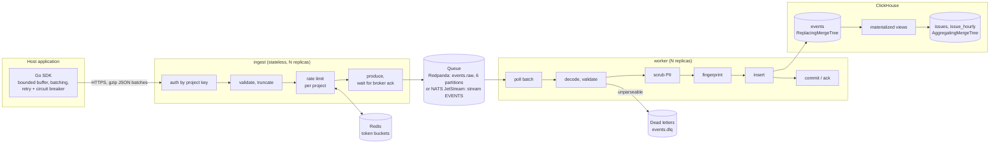

# faultline

A self-hosted error and event ingestion pipeline in Go. Applications report
errors through a Go SDK. A rate-limited HTTP ingest service writes them to a
durable queue (Redpanda, or NATS JetStream). Workers scrub personal data, group
events into issues, and store them in ClickHouse.

The project is built around one question: **what happens to an event when
something breaks?** Every part of the design is there to answer it, and the
failure tests measure the answer.

Status: the pipeline, the load generator, the benchmarks, the failure tests and
the NATS adapter are done. There is no UI and no OpenTelemetry instrumentation
yet.

---

## Architecture



### The path of one event

1. **SDK.** `CaptureError` puts the event in an in-memory buffer and returns, in
   under a millisecond at p99. A background goroutine sends batches of 50
   events, gzip-compressed.
   - Each event has a UUIDv7 `event_id` created on the client. Retries reuse it.
   - Network errors, 429 and 5xx are retried with backoff and jitter, and
     `Retry-After` is honored.
   - After 5 failures in a row, a circuit breaker pauses sending for 30 seconds.
   - The buffer is bounded at 1,000 events. Beyond that, events are dropped and
     counted, never blocked on.
2. **Ingest.** Ingest checks the request in order:
   - It authenticates the project key.
   - It validates each event. An invalid event is rejected alone, not the whole
     batch.
   - It charges the batch against the project's token bucket in Redis.
   - It writes the batch to the queue.

   Ingest answers **202 only after the broker has acknowledged the write**. A
   202 is therefore the durability boundary: from that point the event survives
   an ingest crash. If the broker doesn't acknowledge within 5 seconds, ingest
   answers 503 with `Retry-After`, and the SDK retries.
3. **Queue.** The queue buffers between ingest and storage. A slow or
   unavailable ClickHouse turns into consumer lag instead of failed requests.
4. **Worker.** The worker processes batches in a fixed order:
   - It polls a batch of up to 10,000 messages, or 1 second's worth.
   - It decodes and validates each message. Messages it can't parse go to the
     dead-letter queue, together with the reason.
   - It scrubs personal data.
   - It computes each event's grouping fingerprint.
   - It inserts the batch into ClickHouse.
   - **Only after the insert succeeds** does it commit Kafka offsets, or ack
     NATS messages.

   If the insert fails, the worker retries with exponential backoff (200 ms,
   doubling, up to 5 s) and never gives up. Nothing is committed while it
   retries.
5. **ClickHouse.** `events` keeps one row per event, 30 days. Materialized views
   keep the issue list (`issues`) and events per issue per hour (`issue_hourly`)
   up to date on every insert.

### Components

| Component | Responsibility | State | Scales by |
| --- | --- | --- | --- |
| `sdk/` | Capture without blocking the app; batch, retry, back off | In-memory buffer, bounded | — (in the app) |
| `cmd/ingest` | Auth, validation, rate limiting, durable hand-off to the queue | None | More replicas behind a load balancer |
| Redis | Shared token buckets for rate limits | Seconds-long, not persisted | — |
| Queue | Durable buffer, decouples ingest from storage | Messages, 1 day retention | Partitions (Redpanda) or consumers (NATS) |
| `cmd/worker` | Scrub, group, store, then commit | The batch in hand only | More workers (Redpanda: up to the partition count, 6) |
| ClickHouse | Event storage and issue aggregates | Events 30 days, issues 90 days | — (single node here) |
| `cmd/migrate`, `cmd/natsinit` | Schema and stream setup, run once at startup | — | — |

Ingest and the worker share no state and talk only through the queue. Grouping
happens in the worker, not in ingest, which keeps ingest fast and stateless;
changing the grouping algorithm only needs new workers.

---

## Delivery guarantees

**At-least-once from the SDK's 202 to ClickHouse, with duplicates removed by
`event_id`.**

| Where | Mechanism | What it prevents |
| --- | --- | --- |
| SDK → ingest | The same `event_id` on every retry | A retried request creates a copy with the same ID, so it can be removed later |
| ingest → queue | 202 only after the broker acks (Redpanda: `acks=all`, idempotent producer; NATS: wait for PubAck) | An event acknowledged to the client but never written |
| ingest → NATS | `Nats-Msg-Id = event_id`; the stream drops repeats within 2 minutes | Duplicates from SDK retries, before they reach storage |
| queue → ClickHouse | Commit or ack **after** the insert | A worker crash between commit and insert losing the batch |
| ClickHouse | `ReplacingMergeTree` ordered by `event_id`, plus insert-block deduplication | Redelivered batches stored twice; `FINAL` or a merge removes them |
| Issue counts | `uniqCombined64(event_id)` in the aggregates | Duplicates counting twice before a merge |

**What can be lost, by design, and is counted:**
- **The SDK buffer is full:** for example, ingest has been down for longer than
  the buffer covers. The drop is counted in the SDK's `Stats().Dropped`.
- **A batch can't be delivered within `MaxRetryDuration` (1 minute):** it is
  counted in `Stats().Failed`.
- **A project is over its rate limit:** the excess events are rejected with 429.

The SDK accounts for every event: `Captured = Sent + Failed + Queued +
InFlight`, with dropped and filtered events counted separately. The loss checker
uses these counts to tell expected drops from real loss.

## Backpressure and failure isolation

| What fails | What absorbs it | What the client sees |
| --- | --- | --- |
| ClickHouse slow or down | The worker retries without committing; the queue holds the backlog | Nothing: ingest keeps answering 202 |
| Worker crashes | Redpanda: the group moves its partitions to another worker after the session timeout. NATS: unacknowledged messages are redelivered after AckWait | Nothing |
| Queue down | Ingest answers 503 + `Retry-After` (NATS: at once; Redpanda: requests wait until it is back) | The SDK retries from its buffer |
| Ingest down | The SDK buffers up to 1,000 events, then drops and counts; the breaker stops hammering | The app keeps running; `CaptureError` stays under 15 ms |
| Redis slow or down | After 50 ms, ingest falls back to local per-instance limits (fail open) | Normal service; limits become per instance |
| One project floods | Its token bucket runs empty: 429 for that project only | Other projects are unaffected |

---

## Processing

**PII scrubbing.** The worker scrubs every event before grouping and storage, so
personal data never reaches a fingerprint, an issue title or a stored row. It
removes:
- **Secrets by key:** `password=…`, `Authorization: Bearer …` and similar.
- **Contact and payment data:** email addresses, and card numbers that pass the
  Luhn check.
- **IP addresses:** both IPv4 and IPv6, unless the project explicitly keeps
  them.
- **User names in home directory paths.**

There is no switch to turn scrubbing off. Cheap prefilters skip the regexes for
strings that can't match. An equivalence test checks that the fast path gives
the same output as running every regex, over 50,000 random inputs.

**Grouping.** Each event gets a fingerprint; events with the same fingerprint in
the same project are one issue. The fingerprint is built from:
- the exception type plus the innermost 3 in-app frames, each reduced to module
  and normalized function name;
- the normalized message as well, for generic error types such as plain
  `errors.New` text.

Line numbers and file paths are ignored, because they change with unrelated
edits and differ between build machines. The algorithm is versioned, and a
golden test guards against changing fingerprints by accident: a change would
split every existing issue in two.

## Data model

```
events        ReplacingMergeTree   ORDER BY (project_id, fingerprint, timestamp, event_id)
              PARTITION BY day, TTL 30 days (whole parts dropped)
issues        AggregatingMergeTree ORDER BY (project_id, fingerprint)        ← issues_mv
              title, culprit, level, first_seen, last_seen, distinct events
issue_hourly  AggregatingMergeTree ORDER BY (project_id, fingerprint, hour)  ← issue_hourly_mv
```

The `events` sort key serves the main query, "the events of this issue, newest
first", from a contiguous range. `issues` and `issue_hourly` are maintained at
insert time, so the issue list and the per-issue chart never scan raw events.

---

## The queue is an interface

Ingest and the worker depend on `internal/queue`, not on a broker. There are two
implementations, `internal/kafka` (Redpanda) and `internal/natsjs` (NATS
JetStream), chosen at startup with `QUEUE=kafka|nats`. Both run the same images.

| Concept | Redpanda (Kafka protocol) | NATS JetStream |
| --- | --- | --- |
| Where events go | Topic `events.raw`, 6 partitions | Stream `EVENTS`, subject `events.raw` |
| Shared consumption | Consumer group; each partition belongs to one worker | One durable pull consumer; the server hands each message to whichever worker asks |
| Worker scaling limit | Partition count (6) | None from the broker |
| Marking work done | Commit the highest offset per partition | Ack each message by itself (`AckAll` would ack messages another worker still holds) |
| Worker dies | Partitions move after the session timeout (about 45 s) | Its unacknowledged messages come back after AckWait (30 s); new messages flow to the survivors at once |
| Slow batch | No per-message deadline | The worker sends "in progress" every 10 s while it retries, so the batch isn't handed out again (`queue.KeepAliver`, implemented only by NATS) |
| Producer duplicates | Idempotent producer: covers the client's own internal retries | Message ID deduplication: also covers separate SDK retries within 2 minutes |
| Broker briefly down | Ingest requests wait (p99.9 up to 4.6 s) | Publishes fail at once, ingest answers 503, the SDK retries |

Testing the adapter found one real bug. The first NATS consumer used the client
library's continuous message iterator. After a NATS restart it stopped
requesting messages, and the worker sat idle with 61,000 events waiting. The
events were safe in the stream and all drained once the bug was fixed. The
cause: the library only notices a reconnect during one long wait, and the worker
polls in short calls. The fix was to make each poll its own pull request, so
there is no client-side state to lose across a reconnect.

---

## Measured results

All numbers come from one Windows laptop running the whole stack in Docker
Desktop, with the load generator on the same machine. That is enough to compare
configurations and observe failure behavior. It is not a capacity figure for
real hardware.

### Failure tests

`scripts/failure-tests.ps1` runs each test against a fresh stack with an empty
database: load, a fault injected at a fixed second, recovery, then an exact loss
check and a chart. **Loss** compares sequence numbers: generated minus stored,
minus what the SDK knowingly dropped or gave up on. Anything left over is real
loss.

| Test (Redpanda) | Load | Fault | Result |
| --- | --- | --- | --- |
| Kill a worker | 3,000/s, 2 workers | `docker kill` (SIGKILL) one worker at 30 s, restart at 100 s | 442,500 generated, all stored, **LOSS 0**. Lag peaked at 73k while the group waited out the session timeout, then drained |
| Stop ClickHouse | 3,000/s | Down 60 s | 352,500 stored, **LOSS 0**. Ingest p99 46 ms, 0 SDK retries. Lag rose to 189k and drained. Retries backed off 200 ms → 5 s |
| Flood one project | 2,000/s normal + 500/s against a 50/s limit | The noisy project for 60 s | Noisy: 4,615 accepted (= 50/s + burst), the rest 429; 21,529 dropped and 3,856 given up by its SDK, all counted. Normal projects: 175,000 stored, **LOSS 0**, p99 58 ms |
| Stop ingest | 1,000/s, 10 apps | Down 30 s | 26,396 dropped by the SDKs (buffers full), counted; `CaptureError` p99 0.5 ms, max 14 ms. **LOSS 0** |
| Restart Redpanda | 2,000/s | `docker compose restart` | 175,000 stored, **LOSS 0**. No 503s: requests waited, p99.9 4.6 s |

The NATS adapter was also run locally, against a single NATS server, ClickHouse
and Redis outside Docker:

| Test (NATS) | Result |
| --- | --- |
| Kill a worker | 202,500 stored, **LOSS 0**. Lag peaked at 5.6k (versus 73k on Redpanda): no rebalance wait |
| ClickHouse down 45 s, longer than AckWait | 232,500 stored, **LOSS 0**. Lag 147k, drained. The batch in hand was held, not redelivered |
| Restart NATS | **LOSS 0**. 60 requests got 503 and were retried. 901 duplicate rows from acks lost in the restart; **0 after the merge** |

### Benchmarks

| Change | Effect |
| --- | --- |
| Worker batch 1,000 → 10,000 | ClickHouse store time per 1,000 events 82 → 21 ms; ClickHouse insert time over the run 41 s → 8 s; drain after the load 48 s → 19 s |
| Scrub prefilters | 6.7 µs and 21 allocations per event on the test machine (microbenchmark) |

The end-to-end comparison for the scrub prefilters is not usable. During that
run the machine slowed down: unchanged stages were 1.5 to 1.9× slower too, so
the pipeline-level difference can't be attributed to the change.

---

## Known limitations

- **Single node everywhere.** One Redpanda or NATS node, one ClickHouse:
  `acks=all` waits for one replica, and no test covers losing a disk. A graceful
  broker restart loses nothing. A hard kill or power loss could lose writes the
  broker acknowledged but hadn't yet synced to disk: both brokers run with
  relaxed fsync here.
- **The flood test used a well-behaved client.** The noisy SDK honored
  `Retry-After`, so it made only 270 requests. A client that ignores 429s would
  put more load on ingest; that isn't tested.
- **The kill-worker test showed no duplicates on Redpanda.** A random kill
  almost never lands between insert and commit. The deduplication path is shown
  by the NATS restart test (901 → 0), not by the kill test.
- **Load and stack share one machine.** The load generator competes with the
  services for CPU, so the throughput numbers are lower bounds.
- **No UI or metrics export yet.** Progress shows up in logs and debug
  endpoints; OpenTelemetry is planned.
- **The SDK is in the same Go module as the server.** It should become its own
  module before it is published.

---

## Run it

Requires Docker Desktop. Go is needed for the load generator and the tests;
without Go, `.\tasks.ps1 test` runs the tests in a container.

```powershell
.\tasks.ps1 up             # build and start (Redpanda)
.\tasks.ps1 test           # unit tests
.\tasks.ps1 logs           # follow logs
.\tasks.ps1 down -Volumes  # stop and wipe data
```

On NATS JetStream instead of Redpanda:

```powershell
docker compose -f docker-compose.yml -f docker-compose.nats.yml up -d --build
```

Send a few events and look at them:

```powershell
go run ./examples/basic
docker compose exec clickhouse clickhouse-client --user faultline --password faultline -d faultline `
  -q "SELECT title, culprit, level, events, first_seen, last_seen FROM issue_summary WHERE project_id = 'demo' ORDER BY last_seen DESC"
```

Load test, failure tests and loss check:

```powershell
go run ./cmd/loadgen -apps 20 -rate 3000 -duration 60s -ramp 5s -label baseline
.\scripts\failure-tests.ps1 -Test all               # about 20 minutes; add -Queue nats for NATS
go run ./cmd/losscheck -run-id <run-id> -optimize   # sent vs stored; -optimize forces the merge
```

Results go to `bench/results/`, charts to `bench/charts/`.

Integration tests need the stack up:

```powershell
go test -tags integration ./internal/kafka/ ./internal/clickhouse/ ./internal/ratelimit/ ./internal/loadgen/
go test -tags integration ./internal/natsjs/        # with the NATS stack
```

### Local endpoints

| Service | Address |
| --- | --- |
| Ingest API | http://localhost:8080 (`POST /api/v1/events`, `/healthz`, `/readyz`, `/debug/stats`) |
| Redpanda | localhost:19092 |
| NATS (with the override) | localhost:4222, monitoring http://localhost:8222 |
| ClickHouse | http://localhost:8123, native localhost:9000 (user and password `faultline`) |
| Redis | localhost:6379 |
| Worker pprof and stage timings | http://localhost:6060 (`/debug/stages`), 6061 to 6065 for more workers |
| Ingest pprof | http://localhost:6070/debug/pprof/ |

All ports are bound to 127.0.0.1. Project keys and per-project rate limits are
in `deploy/projects.json`.

### Layout

| Folder | What it holds |
| --- | --- |
| `sdk/` | Go client library (package `faultline`) |
| `event/` | Event types, validation, wire limits |
| `cmd/ingest`, `internal/ingest` | HTTP ingest |
| `cmd/worker`, `internal/worker` | Consume, scrub, group, store, commit |
| `internal/queue` | Broker-neutral producer and consumer interfaces |
| `internal/kafka`, `internal/natsjs` | Redpanda and NATS JetStream implementations |
| `cmd/natsinit` | Creates the NATS streams and consumer |
| `internal/ratelimit` | Redis token bucket with local fallback |
| `internal/scrub`, `internal/grouping` | PII scrubbing, fingerprinting |
| `internal/clickhouse`, `cmd/migrate`, `migrations/` | Storage client and schema |
| `cmd/loadgen`, `internal/loadgen` | Load generator, latency histograms, loss accounting, charts |
| `cmd/losscheck`, `cmd/benchplot` | Sent vs stored per run; HTML charts from results |
| `scripts/` | `failure-tests.ps1`, `machine-info.ps1` |
| `docs/` | [Event contract](docs/event-contract.md), [decisions log](docs/DECISIONS.md) |